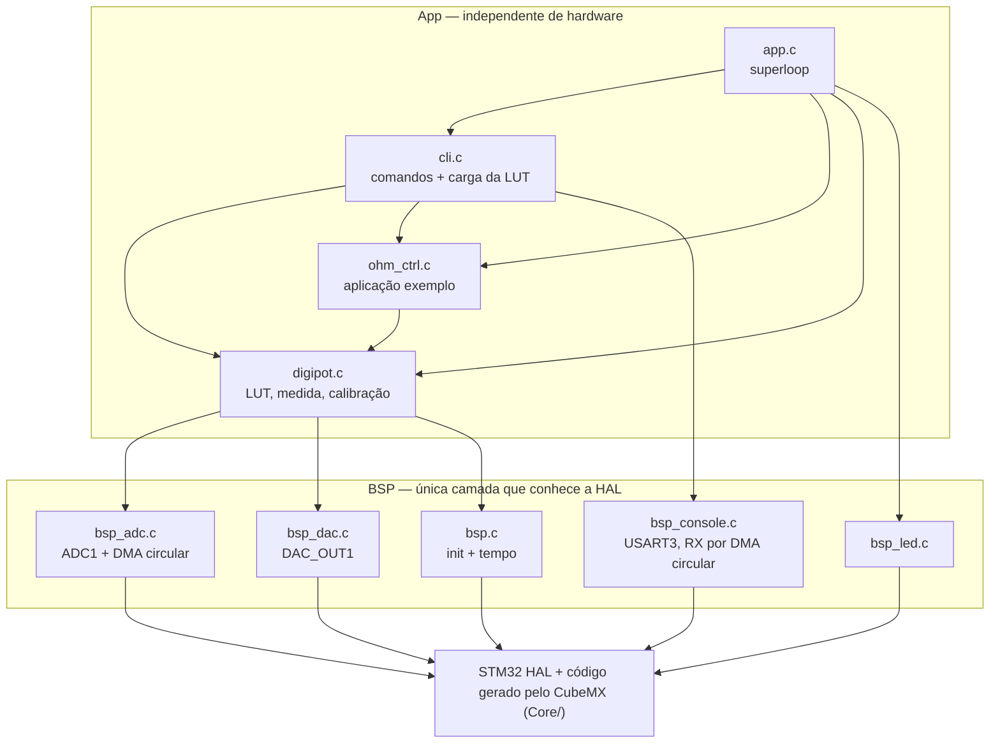
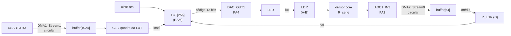
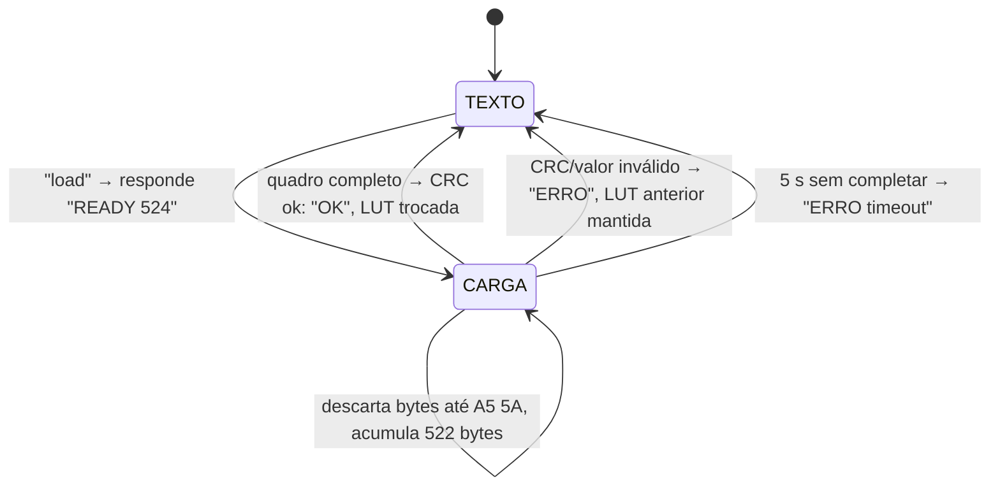
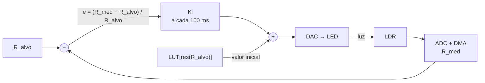

# Lab ADC, DAC e DMA STM32 — Digipot com LED + LDR

Formação em Sistemas Embarcados Virtus-CC — Curso 2: Introdução aos Microcontroladores de 32 bits (Bare Metal).

Implementa um **potenciômetro digital (digipot)**: um LED acionado pelo **DAC** ilumina um LDR, e a
resistência A-B do LDR é selecionada por uma palavra digital `uint8_t res` através de uma
**look-up-table (LUT)**. O **ADC** (com **DMA**) mede a resistência do LDR por um divisor de tensão, e a
LUT pode ser **sobrescrita pela UART, via DMA**, quando o LED ou o LDR forem trocados.

| Item | Valor |
|---|---|
| Placa | NUCLEO-F767ZI (STM32F767ZIT6, Cortex-M7 @ 216 MHz) |
| Ferramentas | STM32CubeMX 6.18 / STM32CubeIDE 2.1, HAL FW_F7 V1.17.4 |
| DAC | DAC_OUT1 (PA4), 12 bits, buffer ligado |
| ADC | ADC1_IN3 (PA3), 12 bits, contínuo, DMA2_Stream0 circular |
| Console | USART3 (Virtual COM do ST-LINK), 115200 8N1, RX por DMA1_Stream1 circular |

## Requisitos atendidos

| Requisito | Onde |
|---|---|
| LED acoplado a LDR, resistência A-B em função de `uint8 res` | `digipot_set()` — `App/Src/digipot.c` |
| Resistor em série com o LDR (divisor de tensão) | seção *Montagem*, `APP_R_SERIES_OHM` |
| Resistência do LDR a partir da tensão do ADC | `digipot_adc_to_ohms()`, `bsp_adc.c` (ADC + DMA) |
| Curva "Resistencia_digipot x uint8 res" | comando `sweep` + `tools/digipot_tool.py curve --plot` |
| Look-up-table do digipot | `s_lut[256]`, `digipot_build_lut()`, comando `cal` |
| Sobrescrever a LUT pela UART, via DMA | comando `load` — `cli.c` + `bsp_console.c` (RX por DMA) |
| **Avançado:** aplicação exemplo | comando `ohm` — resistência programável em ohms com malha fechada (`ohm_ctrl.c`) |
| Roteiro de testes (10 valores + RMSE) | comando `test` e seção *Roteiro de testes* |

## Montagem

```
        DAC_OUT1 (PA4, CN7-17 / D24)                 3V3 (CN8-7)
              |                                        |
            R_led (330 Ω ... 1 kΩ)                  A  o
              |                                        |
             LED  ~~~~ luz ~~~~>                      LDR      <- resistência do digipot
              |        (fita isolante)                 |
             GND                                    B  o-------> ADC1_IN3 (PA3, CN9-1 / A0)
                                                       |
                                                    R_serie (10 kΩ)
                                                       |
                                                      GND (CN8-11)
```

- Enrole LED e LDR, frente a frente, com fita isolante (ou termo-retrátil preto): a luz ambiente altera a medida.
- `R_serie` entra no cálculo da resistência: meça-o com o multímetro e ajuste `APP_R_SERIES_OHM` em `App/Inc/app_config.h`.
- O buffer do DAC fornece pouca corrente (o datasheet especifica carga ≥ 5 kΩ). Se o LED ficar fraco e a
  resistência mínima alta, use um seguidor de emissor (BC547: base no PA4, coletor em 3V3, emissor no `R_led`)
  ou um amp-op como driver. A calibração da LUT absorve a queda de tensão do driver.
- Para medir A-B com o multímetro, o LDR precisa estar **fora do divisor** (solte o fio do 3V3), senão o
  multímetro mede o LDR em paralelo com o restante do circuito.

## Como abrir e executar

1. No STM32CubeIDE: *File → Open Projects from File System…* e selecione a pasta `atividade_04-lab-adc-dac-dma`.
   (O `atividade_04-lab-adc-dac-dma.ioc` abre no CubeMX; o código do usuário está em blocos `USER CODE`, então pode ser regenerado.)
2. Compile (*Build*) e grave (*Run*).
3. Abra um terminal serial a 115200 baud na porta "STLink Virtual COM Port" e digite `help`.

| Comando | Ação |
|---|---|
| `info` | estado atual: `res`, DAC, faixa calibrada |
| `res <0-255>` | aplica a palavra digital pela LUT (0 = menor resistência, 255 = maior) |
| `dac <0-4095>` | escreve o código bruto do DAC, sem LUT |
| `read` | mede ADC, tensão e resistência do LDR |
| `sweep [passo]` | curva R × `res` em CSV |
| `dsweep [pontos]` | curva R × código do DAC em CSV (dados para calibrar) |
| `cal [rmin rmax]` | autocalibração: refaz a LUT medindo o LDR pelo ADC (~19 s) |
| `load` | recebe uma nova LUT pela UART/DMA (quadro binário) |
| `default` | restaura a LUT padrão (não calibrada) |
| `lut` | imprime a LUT |
| `test` | 10 valores de `res`, erro e RMSE |
| `ohm <R>` / `stop` | aplicação exemplo: mantém R ohms em malha fechada / desliga |

LEDs: **verde** piscando = rodando; **azul** = LUT calibrada (ou malha `ohm` travada); **vermelho** = último comando com erro.

## Arquitetura (modularização em BSP)



```
atividade_04-lab-adc-dac-dma/
├── atividade_04-lab-adc-dac-dma.ioc   projeto CubeMX
├── Core/                              gerado pelo CubeMX (main.c chama bsp_init/app_init/app_loop)
├── Drivers/                           HAL e CMSIS
├── BSP/                               pinos, periféricos e DMA
├── App/                               digipot, linha de comando, aplicação exemplo
├── tools/digipot_tool.py              curva, geração/envio da LUT e RMSE pelo PC
├── Doxyfile                           configuração do Doxygen
└── README.md
```

Documentação: `doxygen Doxyfile` gera `docs/html/index.html`.

## Descrição da solução

### Fluxo de sinais



### Medida da resistência (ADC + DMA)

O LDR fica entre 3V3 e o nó do ADC; `R_serie` entre o nó e o GND:

$$V_{ADC} = V_{CC}\,\frac{R_S}{R_S + R_{LDR}} \quad\Rightarrow\quad R_{LDR} = R_S\,\frac{V_{CC}-V_{ADC}}{V_{ADC}} = R_S\,\frac{4095 - N_{ADC}}{N_{ADC}}$$

Como o ADC usa a mesma referência do divisor, a medida é **ratiométrica** (independe do valor exato de 3,3 V).

- ADC1 em modo contínuo, 12 bits, clock PCLK2/8 = 13,5 MHz, amostragem de 480 ciclos (a fonte tem impedância de vários kΩ) → ≈ 27,4 kS/s.
- O DMA grava as conversões em um buffer circular de 64 amostras, sem interrupções; `bsp_adc_read_raw()` devolve a média (janela de ≈ 2,3 ms).
- `digipot_measure()` promedia 8 janelas (≈ 25 ms).
- Só são aceitas medidas com 150 ≤ N ≤ 3945 (≈ R_S/26 a 26·R_S): fora disso a resolução em ohms é ruim.

Resolução da medida (1 LSB), que limita o erro do digipot:

$$\left|\frac{dR_{LDR}}{dN}\right| = \frac{4095\,R_S}{N^2} \qquad\text{(com } R_S = 10\,k\Omega:\ \approx 10\,\Omega \text{ em } R = R_S;\ \approx 300\,\Omega \text{ em } R = 100\,k\Omega)$$

### Look-up-table

A LUT tem 256 códigos de DAC (12 bits), um por valor de `res`, e fica em RAM. Depois de calibrada ela **lineariza** o digipot:

$$R_{nominal}(res) = R_{min} + (R_{max}-R_{min})\,\frac{res}{255}$$

Para cada `res`, o código do DAC é interpolado entre os dois pontos vizinhos da curva medida
$(DAC_i, R_i)$. A interpolação é feita na **condutância** $G = 1/R$, que é aproximadamente linear com a
corrente do LED:

$$DAC = DAC_0 + (DAC_1 - DAC_0)\,\frac{1/R_{alvo} - 1/R_0}{1/R_1 - 1/R_0}$$

Três formas de preencher a LUT:

| Origem | Como | Uso |
|---|---|---|
| Padrão | `default` — rampa linear no DAC: $LUT[res] = 4095 - res\,\frac{4095 - DAC_{min}}{255}$ | ponto de partida, não calibrada |
| Autocalibração | `cal [rmin rmax]` — 64 pontos de DAC, medidos pelo ADC | rápido, sem multímetro |
| UART + DMA | `load` — LUT calculada no PC | recalibração após trocar LED/LDR, ou a partir de medidas do multímetro |

### Recarga da LUT pela UART, via DMA

A recepção da USART3 usa o **DMA1_Stream1 em modo circular** sobre um buffer de 1024 bytes: nenhum byte
gera interrupção, e o superloop descobre o que chegou lendo o contador do DMA
(`escrita = 1024 − NDTR`). O quadro de 524 bytes cabe inteiro no buffer, então não há perda mesmo com
o superloop ocupado.



Quadro (little-endian):

| Offset | Tamanho | Campo |
|---|---|---|
| 0 | 2 | mágico `A5 5A` (sincronismo) |
| 2 | 4 | `r_min` em ohms (`uint32`) — resistência de `res = 0` |
| 6 | 4 | `r_max` em ohms (`uint32`) — resistência de `res = 255` |
| 10 | 512 | 256 códigos do DAC (`uint16`, 0 a 4095) |
| 522 | 2 | CRC16-CCITT-FALSE (poli. 0x1021, inicial 0xFFFF) dos bytes 2 a 521 |

Procedimento de recalibração pelo PC (`pip install pyserial`):

```
python tools/digipot_tool.py curve  --port COM5 --raw --out calib.csv      # dsweep: R x código DAC
python tools/digipot_tool.py upload --port COM5 --csv calib.csv --rmin 1000 --rmax 50000
```

O `calib.csv` também pode ser um arquivo manual `dac;ohms` com resistências medidas no multímetro
(aplique cada código com `dac <n>`).

### Aplicação exemplo: resistência programável em ohms

O comando `ohm <R>` transforma o digipot em uma "década resistiva": um controlador integral ajusta o DAC
até a resistência medida ser igual ao alvo, compensando deriva térmica e envelhecimento. A LUT calibrada
serve de *feedforward* (ponto de partida).



$$e_k = \frac{R_{med,k} - R_{alvo}}{R_{alvo}}, \qquad DAC_{k+1} = DAC_k + K_i\,e_k \qquad (K_i = 60 \text{ códigos},\ T = 100\,ms)$$

Mais luz reduz a resistência, por isso erro positivo aumenta o DAC. O erro **relativo** mantém o ganho de
malha parecido em toda a faixa (a resistência do LDR varia em décadas). `APP_OHM_GAIN_CODES` e
`APP_OHM_PERIOD_MS` devem ser ajustados à constante de tempo do LDR usado.

## Roteiro de testes

1. Calibre (`cal` ou `load`) e aplique os 10 valores abaixo com `res <n>` (o comando `test` aplica os mesmos valores e mostra a medida pelo ADC).
2. Para cada valor, meça A-B com o multímetro (LDR fora do divisor).
3. Calcule o RMSE (`python tools/digipot_tool.py rmse --csv teste.csv`, colunas `res;r_nominal;r_medido`):

$$RMSE = \sqrt{\frac{1}{N}\sum_{i=1}^{N}\left(R_{medido,i} - R_{nominal,i}\right)^2}$$

| `res` | R nominal (Ω) | R multímetro (Ω) | Erro (Ω) |
|---|---|---|---|
| 0 | | | |
| 28 | | | |
| 56 | | | |
| 84 | | | |
| 112 | | | |
| 140 | | | |
| 168 | | | |
| 196 | | | |
| 224 | | | |
| 252 | | | |
| **RMSE** | | | |

4. *A magnitude do erro é aceitável?* — preencher após as medidas. Pontos a considerar: tolerância do LDR
   à temperatura e histerese ("memória de luz"), resolução do ADC no extremo de alta resistência
   (equação acima) e o fato de digipots comerciais terem tolerância de ±20 % no valor absoluto.

## Estado da verificação

- Projeto gerado pelo STM32CubeMX 6.18 a partir do `.ioc` e compilado no STM32CubeIDE 2.1 (Debug): 0 erros, 0 avisos.
- Lógica da LUT, CRC e quadro de carga testada no PC (C × `digipot_tool.py`) com um modelo de LDR.
- **Não testado em hardware:** tempos de acomodação (`APP_SETTLE_MS`), limiar do LED (`APP_DAC_LED_MIN_CODE`)
  e ganho da malha `ohm` são valores iniciais e dependem do LED/LDR usados.
