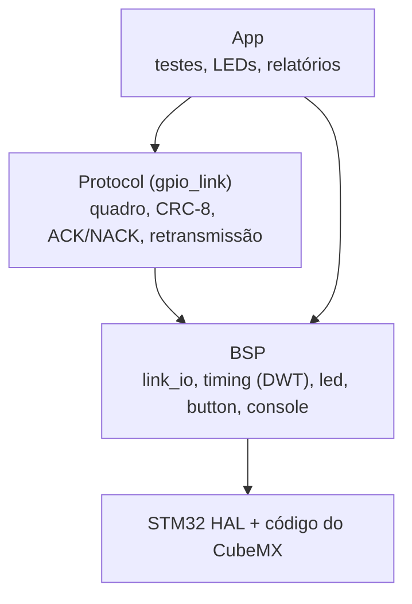
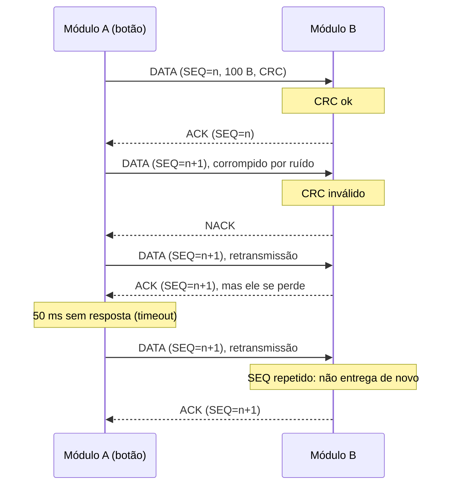
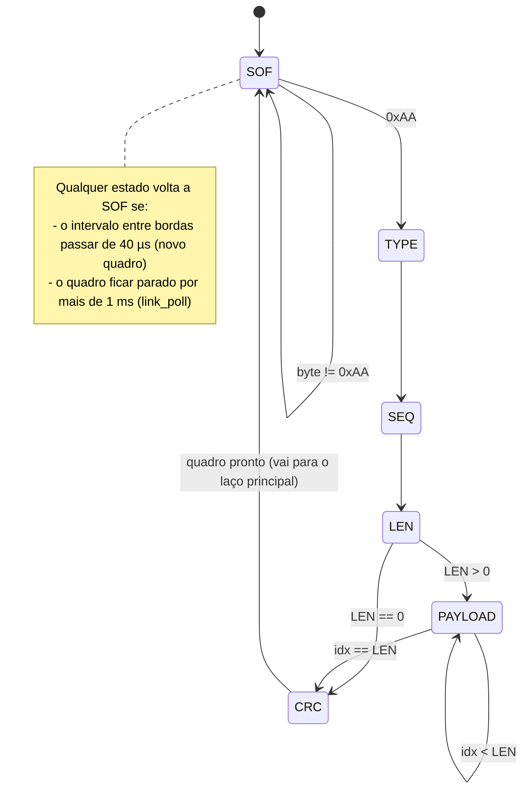
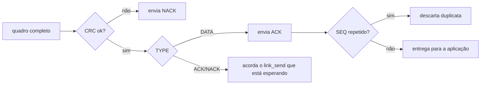

# GPIO-Link: comunicação entre duas STM32 só com GPIO e EXTI

**Lab GPIO e NVIC STM32** (Formação em Sistemas Embarcados Virtus-CC, Curso 2: Periféricos).

> **Critério otimizado: ROBUSTEZ**, ou seja, a maior taxa possível de mensagens entregues corretamente.

Duas placas **NUCLEO-F767ZI** trocam blocos de bytes usando apenas pinos GPIO e interrupções externas (EXTI/NVIC). Nenhum periférico de comunicação (UART, SPI, I²C) participa do protocolo. A USART3 serve só para mostrar logs no PC.

---

## 1. Hardware e ligação

O mesmo firmware vai nas duas placas. Os fios são ligados **em cruz**:

| Placa 1         | fio | Placa 2         |
|-----------------|-----|-----------------|
| D2 (PF15) TX_CLK  | →   | D4 (PF14) RX_CLK  |
| D3 (PE13) TX_DATA | →   | D5 (PE11) RX_DATA |
| D4 (PF14) RX_CLK  | ←   | D2 (PF15) TX_CLK  |
| D5 (PE11) RX_DATA | ←   | D3 (PE13) TX_DATA |
| GND             | —   | GND             |

São 4 fios de sinal e o GND. **O GND em comum é obrigatório.**

| Sinal   | Configuração (CubeMX/BSP)                         |
|---------|---------------------------------------------------|
| TX_CLK  | Saída push-pull, *very high speed*, repouso = 0    |
| TX_DATA | Saída push-pull, *very high speed*, repouso = 0    |
| RX_CLK  | `GPIO_EXTI14`, borda de subida, **pull-down**, NVIC prioridade 0 |
| RX_DATA | Entrada, **pull-down**                             |
| B1 (PC13) | `GPIO_EXTI13`, borda de subida: dispara os testes |
| LD1/LD2/LD3 | PB0 verde = TX, PB7 azul = OK, PB14 vermelho = erro |
| USART3 (PD8/PD9) | Log via ST-LINK Virtual COM, 115200 8N1  |

Clock: HSE 8 MHz (bypass do ST-LINK) → PLL → **216 MHz**.

---

## 2. Arquitetura do firmware (estilo BSP)

```
atividade_01-lab-gpio-nvic/
├── Core/            ← gerado pelo CubeMX (main.c só chama bsp_init/app_init/app_loop)
├── BSP/             ← única camada que conhece pinos e periféricos
│   ├── bsp.c/h            despacho das interrupções EXTI, bsp_init()
│   ├── bsp_link_io.c/h    4 linhas do link (HAL_GPIO)
│   ├── bsp_timing.c/h     atraso em µs e medição de tempo (DWT->CYCCNT)
│   ├── bsp_led.c/h        LEDs
│   ├── bsp_button.c/h     botão com debounce
│   └── bsp_console.c/h    printf → USART3
├── Protocol/        ← independente de placa: só usa a API da BSP
│   ├── gpio_link.c/h      quadros, ISR de recepção, ACK/NACK, retransmissão
│   └── crc8.c/h           CRC-8
└── App/             ← testes do roteiro e relatórios
    ├── app.c/h
    └── app_config.h
```



O programa é **bare-metal**: não há RTOS. A recepção de bits acontece na ISR da EXTI, e o resto roda no superloop (`app_loop()`).

---

## 3. Protocolo

### 3.1 Camada física: serial síncrona

Quem transmite gera o clock. O receptor lê DATA **na borda de subida de CLK**, dentro da ISR da EXTI. Como o clock viaja junto com o dado, as duas placas não precisam ter a mesma frequência de CPU.

```
          |<-- T_HALF -->|<-- T_HALF -->|
 DATA  ===X======= bit n (estável) =====X=== bit n+1 ...
 CLK   ________________/‾‾‾‾‾‾‾‾‾‾‾‾‾‾‾\________________
                       ^
                       EXTI → ISR lê DATA (3 vezes, voto da maioria)
```

| Parâmetro | Valor | Significado |
|---|---|---|
| `LINK_T_HALF_US` | 5 µs | meio período: 10 µs por bit, **100 kbit/s** brutos |
| `LINK_T_IDLE_US` | 100 µs | silêncio antes de cada quadro |
| `LINK_T_RESYNC_US` | 40 µs | se passar disso entre duas bordas, o receptor começa um quadro novo |
| `LINK_ACK_TIMEOUT_MS` | 50 ms | espera máxima por ACK ou NACK |
| `LINK_MAX_ATTEMPTS` | 5 | tentativas por quadro |

Os bits saem com o **MSB primeiro**. Em repouso, CLK e DATA ficam em 0.

### 3.2 Formato do quadro

```
+------+------+-----+-----+--------------------+-------+
| SOF  | TYPE | SEQ | LEN | PAYLOAD[0..LEN-1]  | CRC-8 |
| 0xAA | 1 B  | 1 B | 1 B |     0..255 B       |  1 B  |
+------+------+-----+-----+--------------------+-------+
        \____________ entram no CRC ___________/
```

| Campo | Descrição |
|---|---|
| SOF  | Início de quadro: `0xAA` (`10101010`) |
| TYPE | `0x01` DATA, `0x06` ACK, `0x15` NACK |
| SEQ  | Número de sequência, com volta após 255 |
| LEN  | Tamanho do payload em bytes |
| CRC  | CRC-8, polinômio `0x07` (x⁸+x²+x+1), valor inicial `0x00` |

Um quadro com os 100 bytes do teste ocupa 105 bytes, ou seja, 840 bits, o que dá **8,5 ms** na linha. ACK e NACK têm LEN = 0 (5 bytes), cerca de 0,5 ms.

### 3.3 Troca de mensagens: stop-and-wait half-duplex

As duas placas falam uma de cada vez: A envia um DATA, B responde ACK ou NACK, e só então A envia o próximo.



### 3.4 Máquina de estados de recepção (por byte, na ISR)



Depois que a ISR entrega o quadro, o laço principal (`link_poll()`) faz o resto:



### 3.5 Mecanismos de robustez

| # | Mecanismo | Problema que resolve |
|---|---|---|
| 1 | **CRC-8** sobre todo o quadro | detecta todos os erros de 1 e 2 bits e rajadas de até 8 bits |
| 2 | **ACK/NACK e retransmissão** (até 5 tentativas) | quadro corrompido é reenviado |
| 3 | **Timeout** de 50 ms | cobre quadro ou resposta perdidos por completo |
| 4 | **SEQ** e descarte de duplicatas | um ACK perdido não faz o dado ser entregue duas vezes |
| 5 | **Ressincronização por silêncio** (40 µs) | uma borda espúria não desalinha os bytes para sempre |
| 6 | **Filtro de glitch**: CLK precisa continuar alto dentro da ISR | ignora pulsos de ruído mais curtos que a latência da ISR |
| 7 | **Voto da maioria** (3 leituras de DATA) | ignora ruído rápido no momento da leitura |
| 8 | **Pull-down** nas entradas | com a outra placa desligada ou em reset, a linha fica em 0 em vez de flutuar |
| 9 | **Clock síncrono** | não depende de baud rate nem de as CPUs terem a mesma frequência |
| 10 | **EXTI com prioridade máxima** (NVIC 0) e buffer duplo | a leitura dos bits não atrasa e a ISR não copia o quadro |
| 11 | **Conferência de ponta a ponta** do conteúdo na App | flagraria até um erro que passasse pelo CRC |

### 3.6 Uso de recursos

| Recurso | Quantidade |
|---|---|
| GPIOs | 4 por placa (2 de saída, 2 de entrada) |
| Linhas EXTI | 1 (RX_CLK) |
| Timers | **nenhum**: os atrasos usam o contador de ciclos DWT |
| Periféricos de comunicação | nenhum |
| Flash e RAM | cerca de 25 KB de Flash e 3,8 KB de RAM (Debug, `-O0`, incluindo a HAL) |

---

## 4. Como compilar, gravar e testar

1. Abra a pasta no **STM32CubeIDE** (*File → Import → Existing Projects into Workspace*).
2. Compile com *Project → Build* e grave a **mesma** imagem nas duas placas.
3. Ligue os 4 fios em cruz e o GND, conforme a seção 1.
4. Abra um terminal serial para cada placa: porta *STLink Virtual COM*, 115200 8N1.
5. Aperte **reset** nas duas. O cabeçalho do GPIO-Link aparece no terminal.
6. No botão azul da placa que vai ser o **módulo A**:

| Ação no botão | Teste |
|---|---|
| clique (menos de 1 s) | **Teste mínimo**: vetor de 100 bytes `{0..99}` de A para B, com o tempo medido |
| segurar 1 a 3 s (o LED azul acende) | **Estresse**: 1000 quadros de 100 bytes, para medir a taxa de entrega |
| segurar mais de 3 s (o LED vermelho acende) | **Estresse com injeção de falhas**: 20% dos quadros saem com 1 bit invertido de propósito |

### 4.1 Testes propostos para o critério de robustez

| Teste | Procedimento | O que se espera |
|---|---|---|
| T1: mínimo | clique no botão | B imprime os 100 valores e "Conteúdo confere"; A mostra o tempo até o ACK |
| T2: taxa de entrega | segurar 1 a 3 s | 1000/1000 entregues, 0 conteúdo divergente |
| T3: erros injetados | segurar mais de 3 s | ~20% de NACKs e retransmissões, e mesmo assim **100% entregues** |
| T4: fio desconectado | soltar TX_DATA durante o T2 e reconectar | timeouts e falhas enquanto está solto; volta sozinho ao reconectar |
| T5: ruído real | encostar o dedo ou um fio longo em RX_CLK durante o T2 | contadores de glitch e CRC sobem; os dados entregues continuam corretos |
| T6: reset no meio | resetar B durante o T2 | A tem timeouts; B volta a receber sem precisar resetar A |

> Anote aqui os valores medidos nas placas (tempo do T1, taxa do T2 e do T3) para o vídeo e a entrega.

Pelos cálculos, o T1 deve levar cerca de 9 ms até o ACK: 8,5 ms do quadro DATA, mais 0,5 ms do ACK, mais o processamento. Isso dá uma taxa útil de aproximadamente 88 kbit/s.

---

## 5. Documentação Doxygen

```bash
doxygen Doxyfile
```

Depois abra `docs/html/index.html`.

---

## 6. Limitações e possíveis evoluções

- **Full-duplex:** os pares TX e RX são fios separados e a recepção é feita por interrupção, então em princípio uma placa consegue receber enquanto transmite. O firmware atual só funciona em modo half-duplex (stop-and-wait), e o full-duplex não foi testado.
- **Multidrop:** daria para acrescentar um campo de endereço e trocar as saídas por open-drain com pull-up. Não foi implementado.
- **Duplicata após reset:** o SEQ inicial depende do instante do primeiro envio. Se o transmissor resetar, existe uma chance de 1/256 de o primeiro quadro novo ter o mesmo SEQ do último recebido e ser descartado como duplicata.
