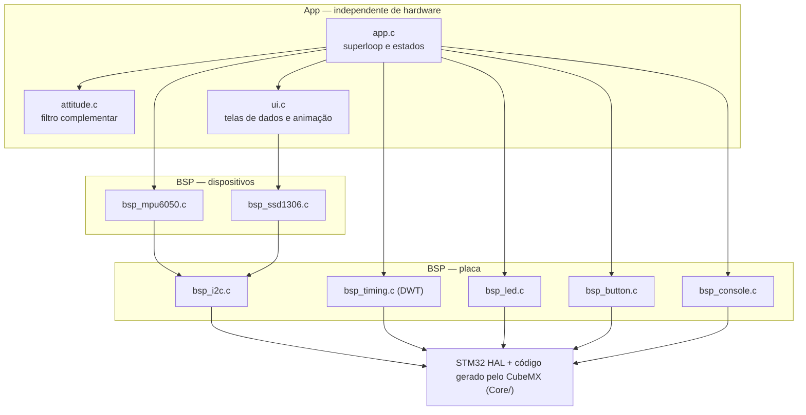
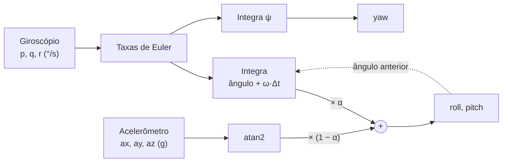
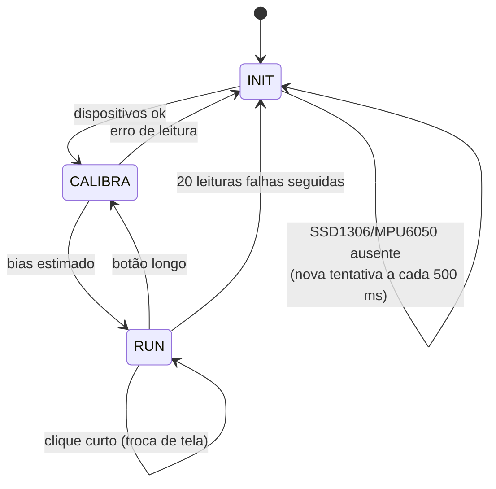

# Lab I2C STM32 — Estimação de atitude com MPU6050 + SSD1306

Formação em Sistemas Embarcados Virtus-CC — Curso 2: Introdução aos Microcontroladores de 32 bits (Bare Metal).

Estima a pose (roll, pitch, yaw) de uma "aeronave" com um **filtro complementar** que funde
acelerômetro e giroscópio de um **MPU6050**, e mostra os resultados em um display OLED
**SSD1306**, ambos no mesmo barramento **I2C**.

| Item | Valor |
|---|---|
| Placa | NUCLEO-F767ZI (STM32F767ZIT6, Cortex-M7 @ 216 MHz) |
| Ferramentas | STM32CubeMX 6.18 / STM32CubeIDE 2.1, HAL FW_F7 V1.17.4 |
| Barramento | I2C1, Fast Mode 400 kHz |
| Log | USART3 (Virtual COM do ST-LINK), 115200 8N1 |

## Requisitos atendidos

| Requisito | Onde |
|---|---|
| Montagem com MPU6050 e SSD1306 | seção *Montagem* |
| Biblioteca para inicializar o MPU e ler aceleração e velocidade angular XYZ | `BSP/Src/bsp_mpu6050.c` |
| Conversão dos valores brutos para unidades de engenharia | `bsp_mpu6050_convert()` |
| Roll, pitch e yaw por filtro complementar | `App/Src/attitude.c` |
| Display com aceleração (3 eixos), velocidade angular (3 eixos) e ângulos | `ui_draw_data()` |
| **Avançado:** animação dos ângulos no display | `ui_draw_anim()` (horizonte artificial + bússola) |

## Montagem

Os dois módulos ficam em paralelo no barramento I2C1 (conector Arduino da Nucleo):

| Sinal | Pino MCU | Conector Nucleo | MPU6050 (GY-521) | SSD1306 |
|---|---|---|---|---|
| SCL | PB8 | CN7 – D15 | SCL | SCL |
| SDA | PB9 | CN7 – D14 | SDA | SDA |
| 3,3 V | — | CN8 – 3V3 | VCC | VCC |
| GND | — | CN8 – GND | GND e AD0 | GND |

- Endereços I2C: MPU6050 = `0x68` (AD0 em GND), SSD1306 = `0x3C`.
- Os módulos GY-521 e SSD1306 já trazem pull-ups em SDA/SCL; o pull-up interno do MCU também está habilitado.
- Fixe o MPU6050 na horizontal, com o eixo **X apontando para o "nariz"** e **Z para cima**.

## Como abrir e executar

1. No STM32CubeIDE: *File → Open Projects from File System…* e selecione a pasta `atividade_03-lab-i2c`.
   (O `atividade_03-lab-i2c.ioc` abre no CubeMX; o código do usuário está em blocos `USER CODE`, então pode ser regenerado.)
2. Compile (*Build*) e grave (*Run*).
3. Mantenha a montagem **parada** durante ~1,5 s após o reset (calibração do giroscópio).
4. Opcional: abra um terminal serial a 115200 baud para ver a telemetria.

| Botão B1 (azul) | Ação |
|---|---|
| clique curto | alterna entre a tela de dados e a tela de animação |
| segurar ≥ 1 s | recalibra o giroscópio e zera o yaw (manter parado) |

LEDs: **verde** piscando = rodando; **azul** = tela de animação; **vermelho** = erro de comunicação I2C.

## Arquitetura (modularização em BSP)



```
atividade_03-lab-i2c/
├── atividade_03-lab-i2c.ioc   projeto CubeMX
├── Core/                      gerado pelo CubeMX (main.c chama bsp_init/app_init/app_loop)
├── Drivers/                   HAL e CMSIS
├── BSP/                       única camada que conhece pinos, periféricos e CIs
├── App/                       filtro, telas e superloop
├── Doxyfile                   configuração do Doxygen
└── README.md
```

## Descrição da solução

### Leitura do MPU6050

`bsp_mpu6050_init()` reinicia o sensor, seleciona o PLL do giroscópio como clock e configura:
DLPF ≈ 44 Hz, taxa de amostragem de 200 Hz, giroscópio em ±500 °/s e acelerômetro em ±4 g.
Cada amostra é lida em **uma única rajada de 14 bytes** (registradores `0x3B`–`0x48`), o que
garante que aceleração, temperatura e velocidade angular pertencem ao mesmo instante.

Conversão para unidades de engenharia:

$$a\,[g] = \frac{raw_a}{8192} \qquad a\,[m/s^2] = a\,[g] \cdot 9{,}80665 \qquad \omega\,[^\circ/s] = \frac{raw_\omega}{65{,}5} - b_\omega \qquad T\,[^\circ C] = \frac{raw_T}{340} + 36{,}53$$

O bias $b_\omega$ do giroscópio é a média de 400 amostras com o sensor parado (`bsp_mpu6050_calibrate_gyro()`).

### Filtro complementar

O acelerômetro mede a direção da gravidade: é uma referência absoluta, mas ruidosa e sensível a
vibração. O giroscópio é preciso em curto prazo, mas sua integral deriva. O filtro complementar
aplica um **passa-altas no giroscópio** e um **passa-baixas no acelerômetro** e soma os dois.



Ângulos observados pelo acelerômetro:

$$\phi_{acc} = \operatorname{atan2}(a_y,\ a_z) \qquad \theta_{acc} = \operatorname{atan2}\left(-a_x,\ \sqrt{a_y^2 + a_z^2}\right)$$

Taxas de Euler a partir das velocidades angulares do corpo $(p, q, r)$:

$$\dot\phi = p + (q\sin\phi + r\cos\phi)\tan\theta \qquad \dot\theta = q\cos\phi - r\sin\phi \qquad \dot\psi = \frac{q\sin\phi + r\cos\phi}{\cos\theta}$$

Fusão:

$$\phi_k = \alpha\,(\phi_{k-1} + \dot\phi\,\Delta t) + (1-\alpha)\,\phi_{acc}$$

$$\theta_k = \alpha\,(\theta_{k-1} + \dot\theta\,\Delta t) + (1-\alpha)\,\theta_{acc}$$

$$\psi_k = \psi_{k-1} + \dot\psi\,\Delta t$$

Com $\alpha = 0{,}98$ e $T_s = 5\,ms$, a constante de tempo é $\tau = \alpha T_s / (1-\alpha) \approx 0{,}25\,s$.
O $\Delta t$ usado é o **medido** pelo contador de ciclos DWT, não o nominal.

Cuidados implementados em `attitude.c`:

- a correção é aplicada sobre o erro reduzido a ±180°, para o roll não "dar a volta" em ±180°;
- se $|a|$ sai da faixa 0,5–1,5 g (aceleração linear forte), usa-se só o giroscópio naquele passo;
- perto de pitch = ±90° (*gimbal lock*) a correção de roll é suspensa e $\cos\theta$ é limitado.

**Limitação do yaw:** o acelerômetro não observa rotação em torno da vertical, então o yaw é
apenas a integral do giroscópio — é relativo à posição em que foi zerado e deriva lentamente
(alguns graus por minuto). Corrigir isso exigiria um magnetômetro.

### Superloop e estados



No estado `RUN`, cada volta do laço executa tarefas cooperativas não bloqueantes:

| Tarefa | Período | O que faz |
|---|---|---|
| `task_sample` | 5 ms (200 Hz) | lê o MPU6050 e executa um passo do filtro |
| `task_button` | toda volta | debounce e eventos do botão |
| `task_display` | quadro a cada ≥ 50 ms | desenha no framebuffer e envia **uma página (~3 ms) por volta** |
| `task_log` | 250 ms | telemetria no console serial |

Enviar o quadro inteiro de uma vez bloquearia ~25 ms (1024 bytes a 400 kHz) e faria perder
amostras; dividindo em 8 páginas, a amostragem continua próxima de 200 Hz.

### Telas

- **Dados:** aceleração linear em m/s² e velocidade angular em °/s nos três eixos, e roll, pitch e yaw em graus.
- **Animação:** à esquerda, um horizonte artificial (a linha gira com o roll e sobe quando o nariz desce (pitch positivo);
  a "terra" é pontilhada); à direita, uma bússola cujo ponteiro indica o yaw.

## Roteiro de testes

Com a montagem na horizontal (Z para cima), resetar e aguardar a calibração. Movimentar em
incrementos de 90° e comparar com o display:

| Movimento | Esperado |
|---|---|
| Parado na horizontal | roll ≈ 0°, pitch ≈ 0°, yaw ≈ 0°, az ≈ +9,8 m/s² |
| Inclinar 90° para a direita (em torno de X) | roll ≈ +90°, ay ≈ +9,8 m/s² |
| Inclinar 90° para a esquerda | roll ≈ −90° |
| De cabeça para baixo | roll ≈ ±180° |
| Nariz 90° para baixo (em torno de Y) | pitch ≈ +90°, ax ≈ −9,8 m/s² |
| Nariz 90° para cima | pitch ≈ −90° |
| Girar 90° sobre a mesa, anti-horário | yaw ≈ +90° |
| Girar 90° sobre a mesa, horário | yaw ≈ −90° |
| Desconectar SDA do MPU6050 | LED vermelho, mensagem de erro; reconectar → recalibra sozinho |

> Os sinais seguem a regra da mão direita nos eixos impressos no módulo. Se a placa for montada
> em outra orientação, os sinais/eixos mudam de acordo.

## Documentação (Doxygen)

Todo o código de `BSP/` e `App/` está comentado em formato Doxygen. Para gerar o HTML:

```bash
doxygen Doxyfile
```

A saída fica em `docs/html/index.html`.
